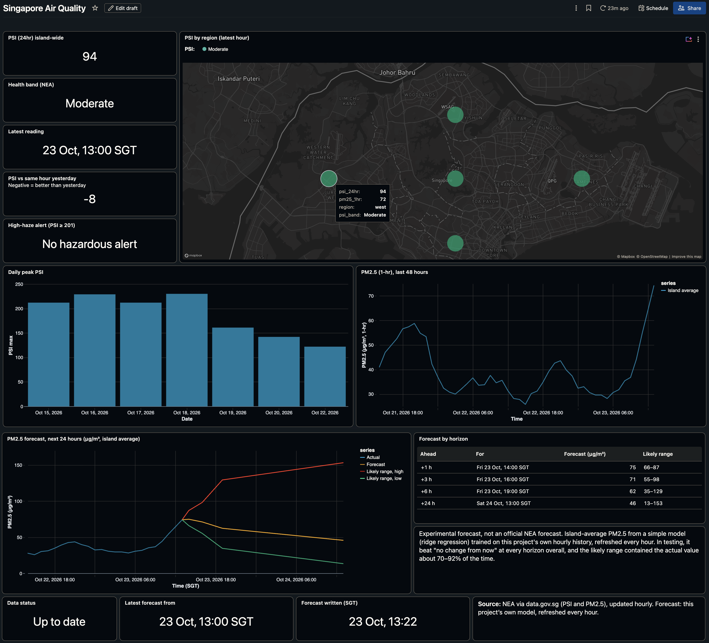

# Hazer Tracker

Near-real-time Singapore haze dashboard on Databricks: PSI and PM2.5 by region from NEA (via data.gov.sg), modelled with a bronze / silver / gold Delta pipeline and shown in an AI/BI dashboard. Built as a Databricks Asset Bundle on Free Edition (serverless only).

> Status: ingest, silver, gold and the dashboard are built and running hourly. Screenshots, a demo and a design-choices write-up are still to come.

## Architecture

```
data.gov.sg (NEA PSI + PM2.5)
        │  hourly scheduled job (retries, failure rows kept)
        ▼
bronze_nea_air_quality    raw JSON, append-only, one row per request
        │  flatten by region, parse to SGT, merge (incremental)
        ▼
silver_psi, silver_pm25   one row per (reading time, region)
        │  hourly / daily rollups, health bands, high-haze flag
        ▼
gold_*, ref_*             dashboard-ready tables
        ▼
AI/BI dashboard           "Singapore Air Quality"
```

The hourly job runs three notebook tasks in order: `ingest` -> `silver` -> `gold`. Silver runs even if ingest fails (so a failed fetch does not block data already in bronze); gold runs only if silver succeeds. Gold tables are rebuilt on every run, so a backfilled gap heals automatically.

## Data source

| Endpoint | Content |
|---|---|
| `https://api-open.data.gov.sg/v2/real-time/api/psi` | 24h PSI, sub-indices and pollutant concentrations by region |
| `https://api-open.data.gov.sg/v2/real-time/api/pm25` | 1-hour PM2.5 (µg/m³) by region |

* Regions: north, south, east, west, central (with label coordinates in `regionMetadata`, used for the map).
* No API key needed; an optional `x-api-key` header gives higher rate limits. Without a key, 429s are possible, so the client backs off and retries.
* `?date=YYYY-MM-DD` returns a whole SGT day (used for backfill); omitting it returns only the latest reading, so a missed hourly run leaves a gap until that date is backfilled.
* Timestamps are ISO 8601 with a `+08:00` offset. PSI and PM2.5 can carry different latest timestamps at the same moment, so never join them on fetch time. Join on reading timestamp.

## Tables

All tables live in `workspace.hazer`.

| Table | Grain / notes |
|---|---|
| `bronze_nea_air_quality` | One row per API request/page, append-only (see columns below) |
| `silver_psi` | One row per (`reading_ts`, `region`); PSI, sub-indices, SGT date and hour columns |
| `silver_pm25` | Same key and time columns, plus `pm25_1hr` |
| `ref_health_bands` | PSI and PM2.5 band names with inclusive lower and exclusive upper bounds; rebuilt each gold run |
| `ref_regions` | Region label coordinates, taken from `regionMetadata` in the latest good PSI payload (these are NEA label points, not region centres) |
| `gold_hourly_region` | One row per (hour, region): PSI, PM2.5 and their bands |
| `gold_hourly_island` | One row per hour: max and average PSI, worst region, PM2.5 stats, band, `is_high_haze` |
| `gold_daily_region` | One row per (SGT date, region) |
| `gold_daily_island` | One row per SGT date, with `is_complete_day`, peak PSI, `hours_unhealthy_or_worse` and `hours_very_unhealthy` |

**High-haze flag.** `is_high_haze` is true when the island PSI is in the "Very unhealthy" band or worse. The band is looked up from `ref_health_bands` rather than hardcoded. It is based on PSI because NEA health advisories apply to the 24-hour PSI, not to PM2.5 1-hour readings.

### Bronze columns

| Column | Notes |
|---|---|
| `endpoint` | `psi` or `pm25` |
| `request_date` | `YYYY-MM-DD` when backfilling, else null |
| `page` | page number within one fetch run |
| `fetched_at` | UTC instant of the request |
| `http_status`, `ok`, `error` | failed fetches are stored too, so gaps are visible |
| `payload` | raw JSON body, untouched |

## Dashboard

Design decisions and known limitations are in [docs/design-choices.md](docs/design-choices.md).



"Singapore Air Quality" is an AI/BI dashboard with one page, "Overview": counters (PSI, health band, latest reading, change versus the same hour yesterday, very unhealthy alert), a map of the five regions coloured by PSI band, a PM2.5 trend for the last 48 hours, and a daily peak PSI chart for the last 7 complete days. Its datasets use SGT date and hour columns, so the charts do not drift with time zones.

The dashboard is exported into the bundle (`src/singapore_air_quality.lvdash.json` and `resources/singapore_air_quality.dashboard.yml`), so `bundle deploy` creates a copy named `[dev] Singapore Air Quality`. Two things to know:

* The YAML hardcodes `warehouse_id`. Replace it with the ID of your own serverless SQL warehouse before deploying.
* The hourly refresh schedule was set by hand on the published original, not in the bundle. The deployed copy has no refresh schedule of its own.

## Setup

1. Install the [Databricks CLI](https://docs.databricks.com/aws/en/dev-tools/cli/install) and run `databricks auth login --host <workspace-url>`.
2. Set the alert address for failure emails in your shell: the bundle variable is `alert_email`, supplied through the `BUNDLE_VAR_alert_email` environment variable. Deploying without it fails with a "no value" error.
3. Replace `warehouse_id` in `resources/singapore_air_quality.dashboard.yml` with your own.
4. `databricks bundle validate -t dev`, then `databricks bundle deploy -t dev`. This deploys the three notebooks, the hourly job and the dashboard.
5. Run the job once (`databricks bundle run bronze_ingest_hourly -t dev`, or from the Jobs UI) and check `SELECT * FROM workspace.hazer.bronze_nea_air_quality`.
6. Optional backfill for a past date: `databricks bundle run bronze_ingest_hourly -t dev --notebook-params backfill_date=YYYY-MM-DD`.

After editing `databricks.yml`, `resources/` or a notebook, run `databricks bundle deploy -t dev` again. A `git push` alone changes nothing in Databricks.

Local tests (no Databricks needed):

```bash
pip install -r requirements.txt
pytest
```

## Open questions

* Pagination: the docs describe a pagination token for date-filtered requests, but its exact response field name has not been confirmed against a live multi-page response. The client accepts `paginationToken` or `pagination_token`. Confirm on the first backfill that needs a second page.
* Free Edition limits on public dashboard sharing: not yet confirmed in the workspace.